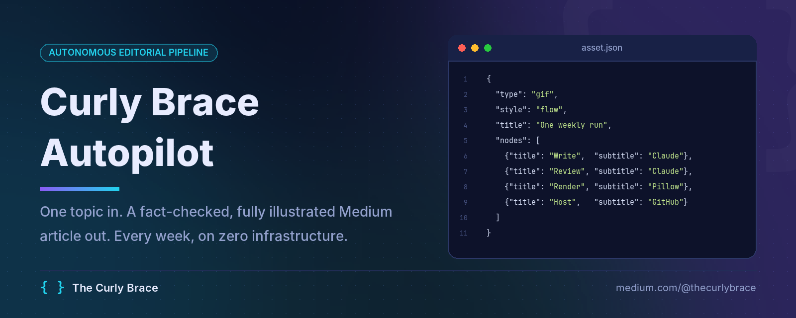
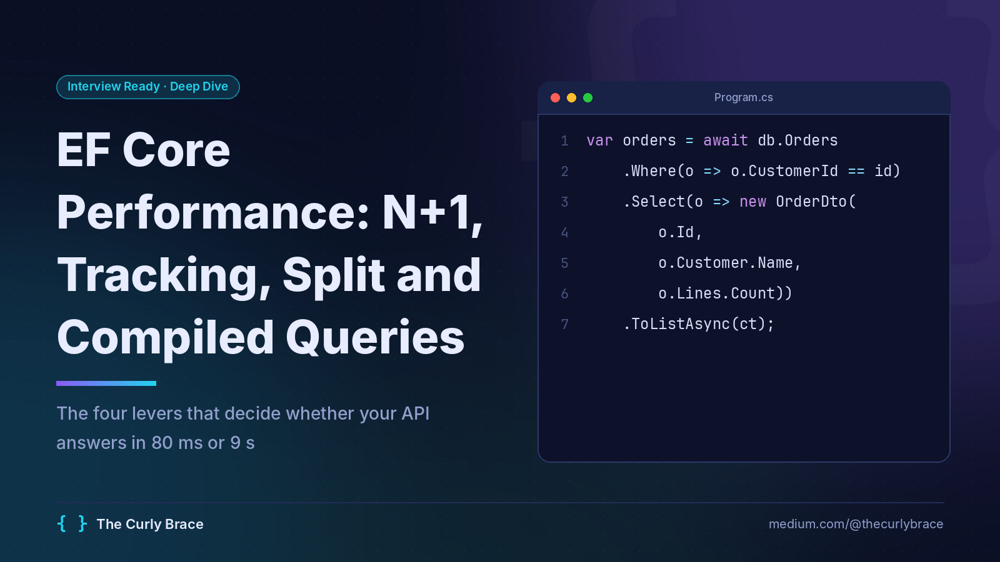
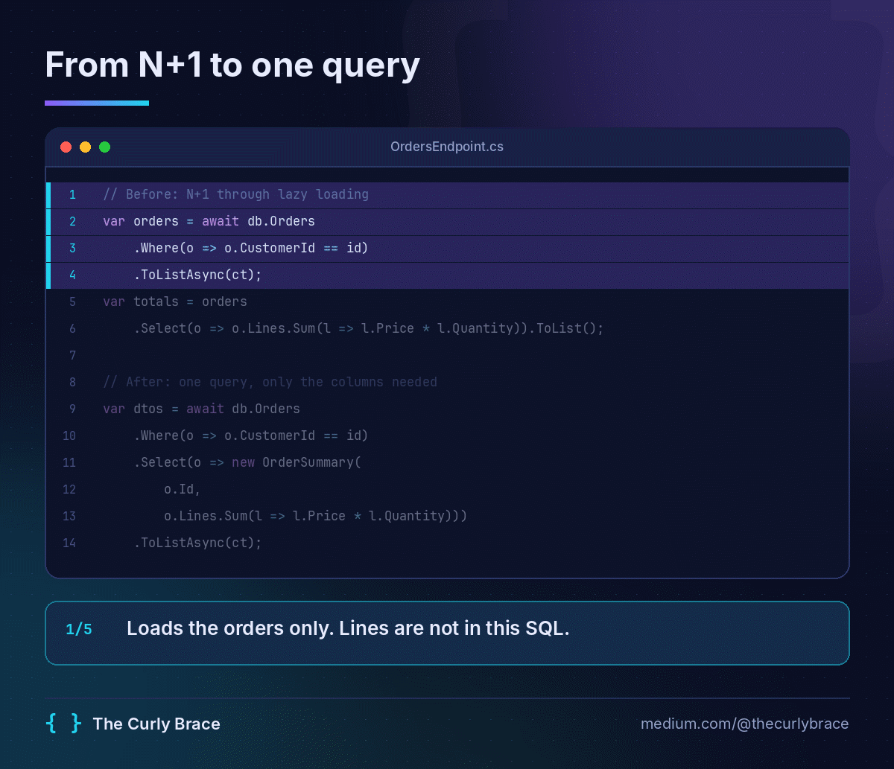
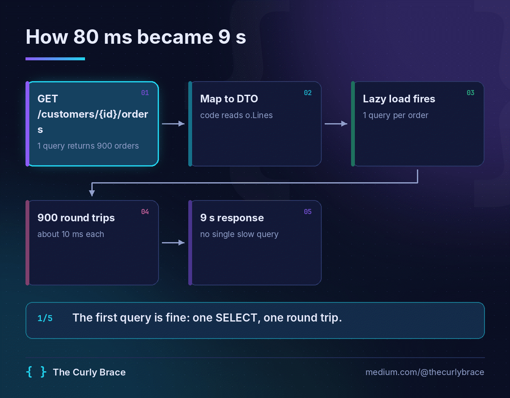
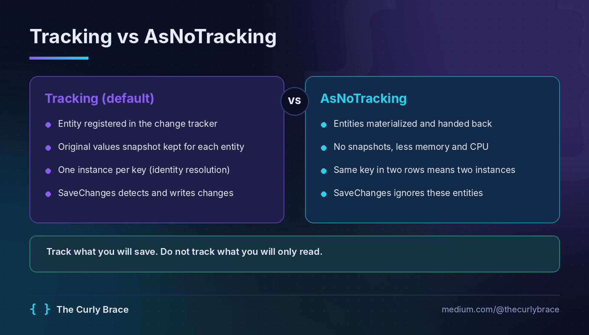
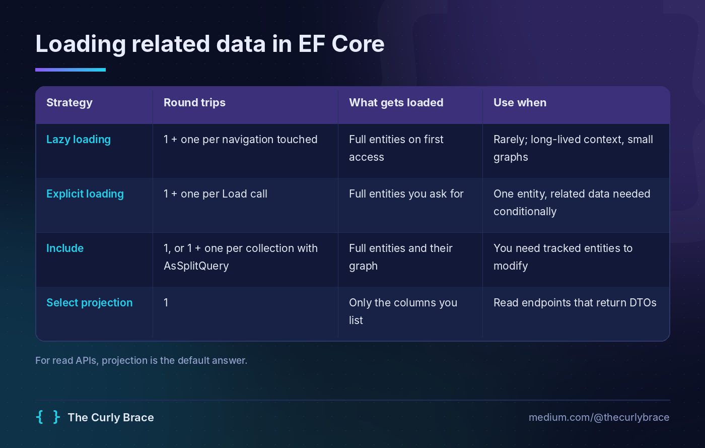
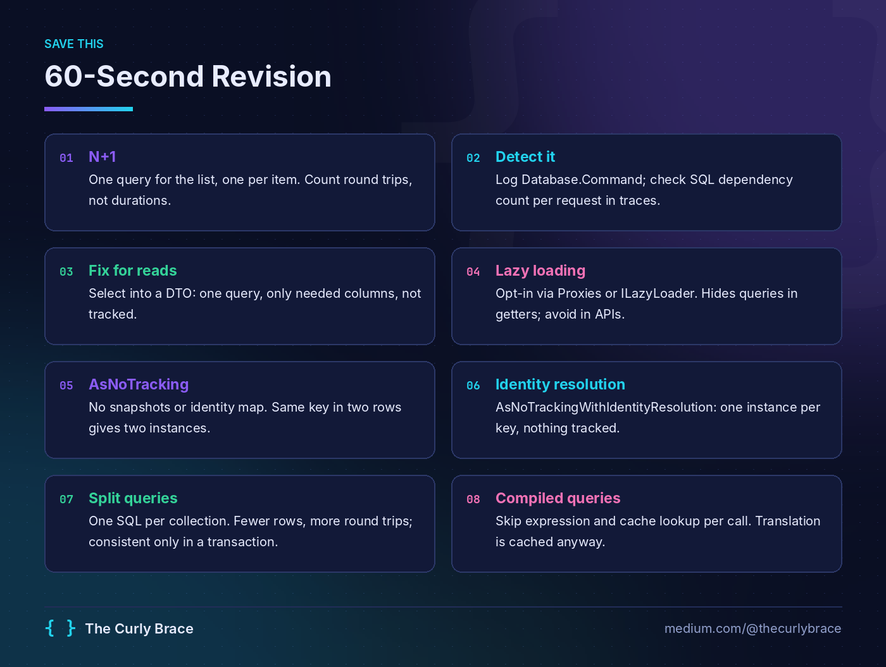
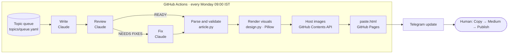

<p align="center">
  
</p>

<p align="center">
  <a href="https://github.com/deeppatel99/curlybrace-autopilot/actions/workflows/autopilot.yml"></a>
  
  
  
  
</p>

<p align="center">
  <a href="#what-one-run-produces">Showcase</a> ·
  <a href="#how-it-works">How it works</a> ·
  <a href="#engineering-decisions">Engineering decisions</a> ·
  <a href="#quick-start">Quick start</a> ·
  <a href="docs/SETUP.md">Full setup guide</a>
</p>

---

**Curly Brace Autopilot** is an autonomous editorial pipeline behind [The Curly Brace](https://medium.com/@thecurlybrace), a Medium publication of .NET and Azure interview deep dives.

Every Monday it picks a topic and the format that suits it best (a deep dive, a bug hunt, a build log, an X-vs-Y decision guide, an interview set or a news analysis). It writes the article with facts checked against official documentation, puts it through an independent technical review, applies the fixes, renders branded diagrams, tables and animated GIFs, hosts everything, and sends a Telegram message with a one-tap **Copy article** page. A human reads the fact-check notes and presses Publish.

It is not a prompt wrapper. The language model only writes text and **JSON specs** for the visuals. Deterministic Python code turns those specs into pixels, validates the article against a strict format contract, and handles the many quirks of getting rich content into Medium. The whole system runs on a Claude subscription and free GitHub features, so it needs no servers, no database and no paid API.

## What one run produces

Every image below came out of a single unattended run (an interview-set article) for *[EF Core Performance: N+1, No-Tracking, Split and Compiled Queries](posts/ef-core-performance-interview-n-plus-one-tracking-split-compiled-queries/article.md)*. None of them is AI-generated art. All are rendered from JSON by [`design.py`](autopilot/design.py).

<table>
  <tr>
    <td width="50%"><br><sub><b>Cover</b>: title, hook and the one snippet that tells the story</sub></td>
    <td width="50%"><br><sub><b>Animated code walkthrough</b>: lines light up step by step with captions</sub></td>
  </tr>
  <tr>
    <td><br><sub><b>Animated flow</b>: each stage activates in order</sub></td>
    <td><br><sub><b>Compare diagram</b>: two approaches and a rule of thumb</sub></td>
  </tr>
  <tr>
    <td><br><sub><b>Table as an image</b>: Medium cannot render Markdown tables</sub></td>
    <td><br><sub><b>60-second revision sheet</b>: made to be screenshotted</sub></td>
  </tr>
</table>

Each article ships with a `review.md` that holds the reviewer's verdict, the issues it found and fixed, and a list of claims a human should double-check against official docs.

## Highlights

- **Six article formats.** Deep dive, bug hunt, build log, X vs Y, interview set (6 to 12 questions, as many as the topic supports) and news analysis. Each has its own shape, length and visual budget, and the planner picks the right one for each topic.
- **Verified, not generated.** In research mode the writer and the reviewer check versions, APIs, defaults and dates against official docs with web search, link those sources inline, and mark every claim in the fact-check notes as verified or unverified. Invented numbers, quotes and "it happened to us" incidents are explicitly forbidden.
- **Three-pass authoring.** A writer, a strict principal-engineer reviewer and an editor run as separate Claude calls with separate system prompts. The reviewer judges accuracy, whether the title's promise is delivered and whether a senior reader would learn something, and the editor applies every high and medium issue.
- **Visuals as code.** Cover, tables, three diagram styles, two GIF styles and a revision sheet, all drawn with Pillow in one consistent brand system. GIFs share a single palette across frames, so colours do not flicker.
- **Format contract, enforced in code.** Every article is checked against the rules of its own format: length band, visual budget, cover first, exactly five tags, the exact call to action, and for interview sets the question structure. Any deviation is reported in `review.md`.
- **Knows the back catalogue.** Every published story (seeded from a Medium data export, kept current from the RSS feed) is in [`topics/published.yaml`](topics/published.yaml). The planner never repeats one, the reviewer flags overlap, and the writer links one or two related past articles inline, which keeps readers moving through the publication.
- **Writes in the author's voice.** The house style was distilled from 65 published articles: cold-open scenes, one analogy for the mechanism, headings that talk like a person, an honest "when not to" section, and a closing takeaway, action and question for the responses.
- **Self-refilling topic queue.** When fewer than two topics remain, Claude plans five more, each with a format and an angle, and rotates across tracks (C#, ASP.NET Core, SQL, Azure, DevOps, AI, system design).
- **Zero infrastructure.** GitHub Actions is the scheduler, the GitHub Contents API is the image CDN, GitHub Pages serves the paste page, and Claude Code runs headless on a Pro subscription.
- **Built for Medium's real editor.** A one-click copy page puts the title, text, hosted images, GIFs and code on the clipboard in the shape Medium's editor accepts on paste, so code blocks stay intact and quotes gain no stray lines.
- **Human in the loop, by design.** The pipeline never publishes on its own. A Telegram update lists what was done, the fact-checks to confirm and what runs next, and a failed run sends an alert with a link to the logs.
- **Resilient by default.** A broken visual spec is repaired by the model once and otherwise skipped with a warning. One bad image never kills a run, and uploads retry on transient GitHub errors.

## How it works



| Stage | Module | What happens |
|---|---|---|
| Plan | [`writer.py`](autopilot/writer.py) | Refills the queue with five new topics, each with a format and an angle |
| Write | [`writer.py`](autopilot/writer.py), [`prompts.py`](autopilot/prompts.py) | Researches, then produces Markdown in the topic's format plus fenced `asset` blocks containing JSON specs |
| Review and fix | [`writer.py`](autopilot/writer.py) | An independent reviewer verifies facts and audits reader value, format and assets, and an editor applies the fixes |
| Parse | [`article.py`](autopilot/article.py) | Reads front matter and swaps each `asset` block for a placeholder |
| Render | [`design.py`](autopilot/design.py) | Turns each spec into a branded PNG or GIF |
| Validate | [`article.py`](autopilot/article.py) | Checks the article against the format contract |
| Host | [`host.py`](autopilot/host.py) | Commits images and pages to `posts/<slug>/` through the GitHub API |
| Publish | [`publish.py`](autopilot/publish.py) | Builds the preview page and the Medium-shaped paste page |
| Notify | [`pipeline.py`](autopilot/pipeline.py), [`notify.py`](autopilot/notify.py) | Sends the Telegram update and writes the GitHub run summary |

## Engineering decisions

**The model writes specs, code draws the pixels.** Asking a model for finished images gives inconsistent results that cannot be checked. Here the model emits small JSON objects with hard limits, such as at most four columns or 22 characters per node title, and `design.py` renders them the same way every time. The brand stays consistent, and every visual is diffable text in `source.md`.

**Trust over volume.** An article that is wrong once costs more readers than ten good ones earn. So the prompts forbid invented figures and incidents. A story the author actually lived is passed in as "author's notes" and used faithfully, while a planner's idea is labelled as an idea and must be told as a recognisable scenario, never as the author's past. With research on, every version-specific claim is checked against official docs before it is written and again in review.

**Format follows the topic.** A bug is best told as a hunt, a design as a build log, a confusing choice as a decision guide. Each format in [`prompts.py`](autopilot/prompts.py) defines its shape, target length and visual budget, and `validate()` checks the article against that format instead of one fixed template.

**Separate writer, reviewer and editor.** A model reviewing its own draft in the same conversation tends to approve it. Splitting the roles into independent calls with opposing incentives catches real problems. In one run the reviewer flagged an SQL-injection example that used an `int` parameter and so could never carry a payload, plus numbers in the hook that disagreed with the GIF.

**A contract, not a vibe.** The article format is written down in the prompt and verified in code by `validate()`. Drift shows up as a warning, not as a surprise after publishing.

**Paste instead of import.** Medium's import tool adds a canonical link back to the source page, which hands the search credit to that page. A paste keeps the story fully native to Medium. The paste page is served with `noindex` so it never competes with the article in search.

**Medium's editor is the real target.** Pasted HTML is rewritten into the shape Medium itself exports. Code blocks become a single `<pre>` joined with `<br>`, because Medium splits a block at every blank line, and blockquotes are flattened so no empty line follows them.

**A subscription as a headless engine.** The writer shells out to `claude -p` with tools disabled, MCP servers off and user-level settings ignored (`--setting-sources project --strict-mcp-config`), so local plugins or instructions cannot leak into an article. An `ANTHROPIC_API_KEY` in the environment is removed so billing stays on the subscription. A paid API backend is one config line away.

**Free platform pieces, no glue servers.** Scheduling, storage, CDN and static hosting all come from a public GitHub repository. The pipeline uses the Contents API instead of `git`, so the same code runs on a laptop and in CI.

## Visuals as code

The writer places a block like this wherever an image belongs:

````markdown
```asset
{"type": "diagram", "style": "compare", "title": "Single query vs split query",
 "left":  {"title": "Single query", "points": ["One round trip", "Cartesian explosion on multiple collections"]},
 "right": {"title": "Split query",  "points": ["One query per collection", "No row duplication"]},
 "verdict": "Split when you include two or more collections"}
```
````

`article.py` swaps the block for an image placeholder, `design.py` renders it, and the hosted URL replaces the placeholder. The available types are `cover`, `table`, `diagram` (`flow`, `layers`, `compare`), `gif` (`flow`, `code`) and `revision`, all documented with their size limits in [`prompts.py`](autopilot/prompts.py).

## Quick start

**Prerequisites:** Python 3.11 to 3.14 (3.15 has no prebuilt wheels for some dependencies yet), [Claude Code](https://claude.com/claude-code) signed in with a Claude Pro or Max account, and a public GitHub repository for image hosting.

```bash
git clone https://github.com/deeppatel99/curlybrace-autopilot.git
cd curlybrace-autopilot

# Windows
setup.bat
run file samples\sample-article.md --dry-run

# macOS / Linux
python3 -m venv .venv && .venv/bin/pip install -r requirements.txt && cp .env.example .env
.venv/bin/python run.py file samples/sample-article.md --dry-run
```

The dry run renders the sample article and its visuals into `out/` without calling Claude or uploading anything. Open `preview.html` to see the result. To go further, add a GitHub token to `.env`, point `hosting.repo` in [`config.yaml`](config.yaml) at your repository, and run `run check`. The [setup guide](docs/SETUP.md) covers every key, the GitHub Actions secrets and the Telegram bot.

## Usage

```text
run check                                   verify Claude login, hosting, Telegram and the queue
run next                                    write and publish the next queued topic
run topic "Span<T> and Memory<T>" --track csharp --format deep-dive
run add "Polly v8 resilience pipelines" --track aspnetcore --format versus
run file path/to/article.md                 render an existing article, no Claude calls

  --format       deep-dive | bug-hunt | build-log | versus | interview | news
  --dry-run      render locally, upload nothing
  --no-review    skip the review and fix passes
  --mode         local | import | api
```

On macOS and Linux, use `.venv/bin/python run.py <command>`. In CI the same commands run from [`.github/workflows/autopilot.yml`](.github/workflows/autopilot.yml), which can also be started by hand with an optional one-off topic.

## Project structure

```text
├── run.py                   CLI entry point (check, next, topic, add, file)
├── config.yaml              all non-secret settings
├── autopilot/
│   ├── pipeline.py          orchestrates one run, end to end
│   ├── writer.py            Claude backends (Claude Code CLI or API): write, review, fix, plan
│   ├── prompts.py           article formats, writer/reviewer/editor/planner prompts, asset spec
│   ├── article.py           front matter, asset extraction, format validation
│   ├── design.py            brand design system and the PNG/GIF renderers
│   ├── host.py              GitHub Contents API uploads and public URLs
│   ├── publish.py           preview and paste pages, Medium-specific HTML shaping
│   ├── queue.py             topic queue
│   ├── published.py         back catalogue: Medium export import + RSS refresh
│   └── notify.py            Telegram and GitHub run summary
├── topics/queue.yaml        upcoming and completed topics
├── topics/published.yaml    everything already live on Medium
├── posts/<slug>/            published output: images, paste.html, article.md, review.md
├── .github/workflows/       weekly schedule and failure alert
├── fonts/                   Inter and JetBrains Mono (SIL OFL)
├── samples/                 demo article for offline runs
└── test_autopilot.py        checks for paste shaping and schedule parsing
```

## Testing

```bash
python test_autopilot.py              # paste-HTML shaping and next-run date parsing
run file samples/sample-article.md --dry-run   # full render path, offline
run check                             # live credentials and integrations
```

## Roadmap

- [ ] Compile every C# snippet in CI with `dotnet build` before an article goes out
- [ ] Cross-post to dev.to and Hashnode with a canonical link to Medium
- [ ] Generate a LinkedIn post and an X thread alongside each article
- [ ] Reply `skip`, `redo` or `add: <topic>` to the Telegram bot to steer the queue from a phone
- [ ] Bundle every five revision sheets into a downloadable PDF

## Author

Built by **Deep Patel**, a senior .NET and Azure backend engineer. Read the articles at [medium.com/@thecurlybrace](https://medium.com/@thecurlybrace).

Fonts: [Inter](https://rsms.me/inter/) and [JetBrains Mono](https://www.jetbrains.com/lp/mono/), both under the SIL Open Font License. Licence texts are in [`fonts/`](fonts/).
