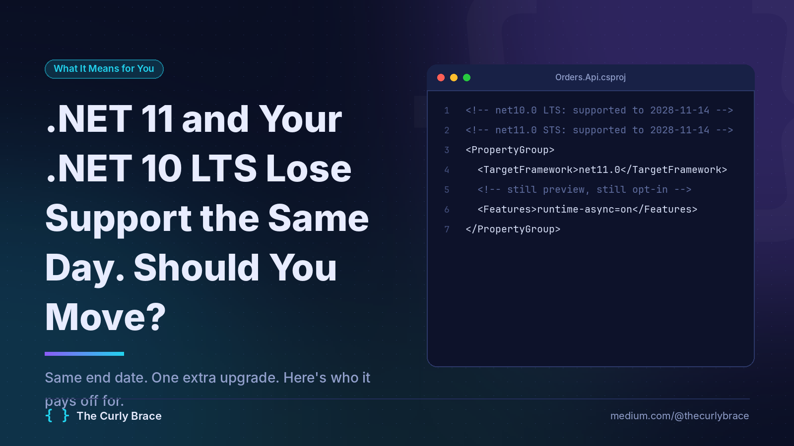
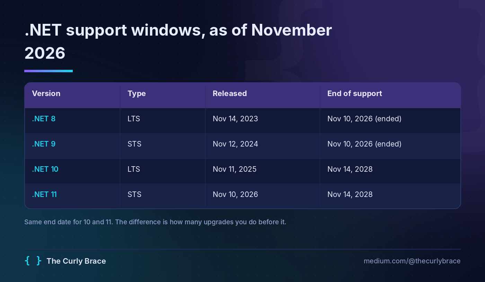
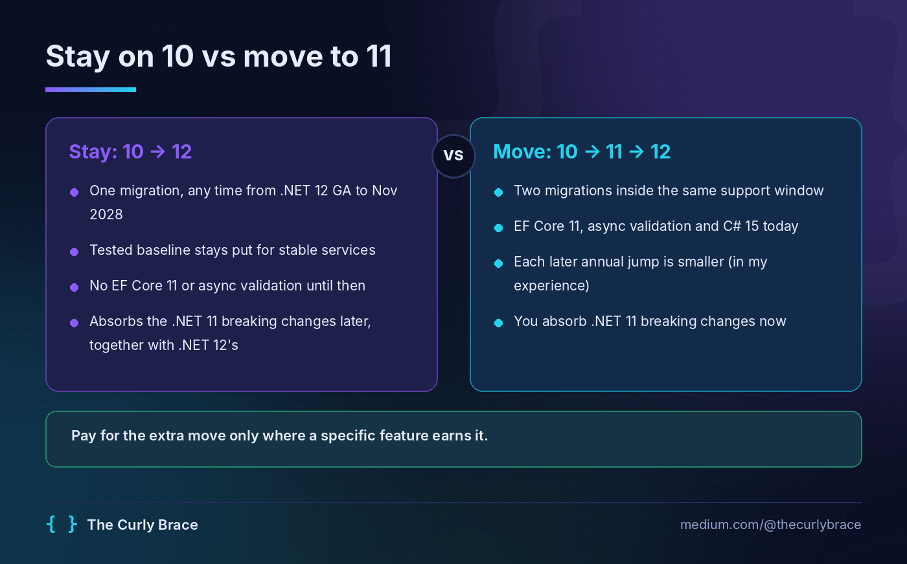
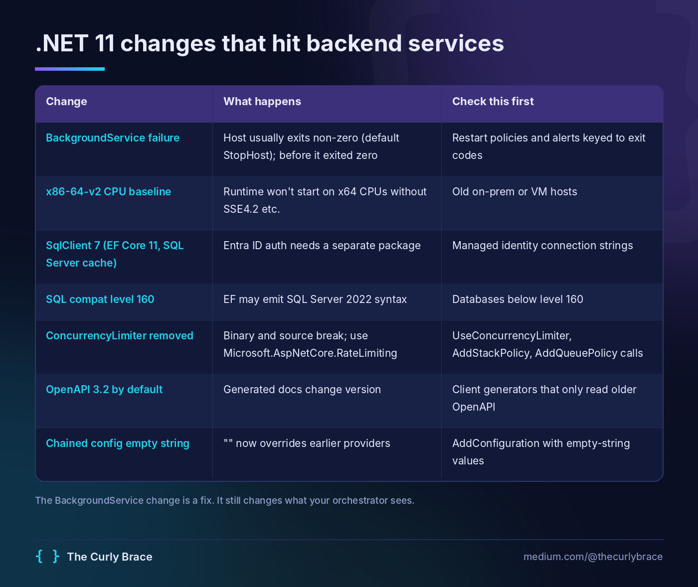

# .NET 11 and Your .NET 10 LTS Lose Support the Same Day. Should You Move?

## An STS release now ends support the same day as the LTS before it, so the real cost is one extra upgrade before .NET 12, and only some of your services will get enough back to pay for it.



It's the Tuesday after .NET Conf. Someone drops the GA announcement into the team channel.

"STS," says the first reply. "Hard pass. We're on LTS."

Four thumbs up.

Then someone opens the support policy page. The .NET 10 row and the .NET 11 row end on the same date: November 14, 2028.

If support length doesn't separate them any more, what should decide whether your production services move?

I asked a version of this question before launch, in [.NET 11 RC2 Has a Go-Live License. Should You Ship It Before November 10?](https://medium.com/@thecurlybrace/net-11-rc2-has-a-go-live-license-should-you-ship-it-before-november-10-1bd237b07f7d). Now the release is final, and this time the question is about your production services.

## What shipped, in two sentences

[.NET 11 reached general availability on November 10, 2026](https://devblogs.microsoft.com/dotnet/announcing-dotnet-11/), with C# 15, EF Core 11 and ASP.NET Core 11. It's an STS release with two years of support and the same servicing as LTS.

## The support argument just died. The upgrade argument didn't.

STS support got longer recently. In September 2025 Microsoft [extended STS support from 18 to 24 months](https://devblogs.microsoft.com/dotnet/dotnet-sts-releases-supported-for-24-months/), starting with .NET 9. Here's how it plays out on the [official support policy page](https://dotnet.microsoft.com/platform/support/policy/dotnet-core):



Think of it as two leases that end on the same day. If you stay on .NET 10, you move house once, to .NET 12, at some point before November 2028. If you move to .NET 11 now, you move twice inside the same two years: into 11 today, then on to 12 later.

One caveat to the analogy: the boxes don't double. Breaking changes carry forward, so a service that jumps from 10 straight to 12 still has to work through every .NET 11 and EF Core 11 breaking change. The EF Core docs tell you to review earlier breaking changes when you skip versions. Moving to 11 now mostly moves that work earlier rather than doubling it. The true extra cost is one more retarget, test and deploy cycle, plus working against changes that haven't settled yet.

Moving twice can still be the right call, if the new place is enough better to be worth that extra cycle. That gives us the real question for each service: does what .NET 11 gives you after the upgrade pay for one extra migration?

If the annual cadence holds, .NET 12 will be the next LTS and arrive in November 2027. That's the usual pattern, not a promise. If it holds, a .NET 10 service has a full year to jump straight to 12.



So let's judge the headline features by what they're worth in your service after the upgrade, not by how they look in a keynote demo.

## Runtime Async: you already have half of it

Runtime Async moves async suspension and resumption out of compiler-generated state machines and into the runtime. The keynote version is cleaner stack traces and less overhead.

What the release notes actually say:

- **For your code, it's still a preview feature.** You opt in per project. On `net11.0` you no longer need `EnablePreviewFeatures`.
- **The runtime libraries are already compiled with it.** Once your service runs on .NET 11, the BCL code under your awaits uses the new model whether or not you opt in.
- **Exception stack traces don't change.** They already looked clean. The improvement is in *live* stacks: profilers, the debugger's call stack window, `new StackTrace()`.

Opting in looks like this:

```xml
<PropertyGroup>
  <TargetFramework>net11.0</TargetFramework>
  <Features>runtime-async=on</Features>
</PropertyGroup>
```

The old `DOTNET_RuntimeAsync` environment variable is gone. To opt a project out, set `<UseRuntimeAsync>false</UseRuntimeAsync>`.

**My verdict:** this is a real improvement that will matter more by .NET 12. But "turn on a preview compiler feature in a production service" is a decision for each service, made on purpose. It's not a reason to migrate on its own.

## Async validation: real, unless you're on controllers

This is the one I'd actually miss. Here's the pattern many .NET 10 codebases contain, because `IsValid` is synchronous:

```csharp
using System.ComponentModel.DataAnnotations;
using System.Threading;
using System.Threading.Tasks;
using Microsoft.Extensions.DependencyInjection;

public interface ISkuCatalog
{
    Task<bool> ExistsAsync(string sku, CancellationToken ct);
}

// .NET 10: the only way to do I/O here is to block
public sealed class KnownSkuAttribute : ValidationAttribute
{
    protected override ValidationResult? IsValid(object? value, ValidationContext context)
    {
        if (value is not string sku) return ValidationResult.Success;

        var catalog = context.GetRequiredService<ISkuCatalog>();
        bool exists = catalog.ExistsAsync(sku, CancellationToken.None).Result;

        return exists ? ValidationResult.Success : new ValidationResult("Unknown SKU.", [context.MemberName!]);
    }
}
```

That `.Result` holds a thread-pool thread for the whole database round trip, on every request. (I covered what that does under load in [One Innocent Line (.Result) Froze My Entire API](https://medium.com/@thecurlybrace/one-innocent-line-result-froze-my-entire-api-i-was-blocking-async-without-knowing-it-8be867b6f4fd).)

In .NET 11 you derive from `AsyncValidationAttribute` instead:

```csharp
using System;
using System.ComponentModel.DataAnnotations;
using System.Threading;
using System.Threading.Tasks;
using Microsoft.Extensions.DependencyInjection;

// .NET 11: same ISkuCatalog as above
public sealed class KnownSkuAttribute : AsyncValidationAttribute
{
    public KnownSkuAttribute() => ErrorMessage = "Unknown SKU.";

    protected override async Task<ValidationResult?> IsValidAsync(
        object? value, ValidationContext context, CancellationToken ct)
    {
        if (value is not string sku || string.IsNullOrWhiteSpace(sku))
            return ValidationResult.Success;

        var catalog = context.GetRequiredService<ISkuCatalog>();

        return await catalog.ExistsAsync(sku, ct)
            ? ValidationResult.Success
            : new ValidationResult(FormatErrorMessage(context.DisplayName), [context.MemberName!]);
    }

    // Required override. Throwing makes an accidental sync call fail loudly.
    protected override ValidationResult? IsValid(object? value, ValidationContext context)
        => throw new InvalidOperationException("Synchronous validation isn't supported.");
}
```

Register it with `builder.Services.AddValidation();` and Minimal APIs validate the request before your handler runs.

The parts the demo skips are in the [ASP.NET Core validation docs](https://learn.microsoft.com/en-us/aspnet/core/fundamentals/validation?view=aspnetcore-11.0):

- **It doesn't cover MVC.** `Microsoft.Extensions.Validation` serves Minimal APIs and Blazor. The docs say it isn't supported for MVC or Razor Pages. If your service is built on controllers, this feature isn't for you yet.
- **Minimal APIs always take the async path.** That's why the throwing `IsValid` above is safe there.
- **Async validators can run in parallel, in no guaranteed order.** Don't write rules that depend on each other. Be careful when two of them resolve the same scoped `DbContext`, because a `DbContext` doesn't support concurrent operations.
- **Missing metadata fails silently.** If the source generator never sees your type, no validation runs, and nothing is logged.

## EF Core 11: the upgrade that touches your data

EF Core 11 requires .NET 11, so you can't get it on your LTS services. What it brings: fewer unnecessary joins in more reference-navigation and split-query cases, better `GroupBy` translation, `FullJoin` translation on relational providers that support it, and complex types and JSON columns on TPT and TPC hierarchies. SQL Server vector search is still experimental.

Useful, but the [EF Core 11 breaking changes](https://learn.microsoft.com/en-us/ef/core/what-is-new/ef-core-11.0/breaking-changes) are where your time will go.

**Microsoft.Data.SqlClient 7.0 moves Entra ID auth into a separate package.** If your connection strings use `Active Directory Default` or `Active Directory Managed Identity`, you now need this:

```xml
<PackageReference Include="Microsoft.Data.SqlClient.Extensions.Azure" Version="7.0.4" />
```

Match the version to the Microsoft.Data.SqlClient your build resolves. The docs show a version number that isn't published on NuGet, and pointing at a missing version gives you warning NU1603, which fails builds that use `TreatWarningsAsErrors`.

This also hits services that don't use EF, through Microsoft.Extensions.Caching.SqlServer: [ASP.NET Core 11 pulls in SqlClient 7.x](https://learn.microsoft.com/en-us/aspnet/core/breaking-changes/11/sqlclient-azure-extensions-required), so `DistributedSqlServerCache` and any other SqlClient path that uses Entra ID needs the package too.

If you followed [I Deleted Every Connection String From Our Azure Apps](https://medium.com/@thecurlybrace/i-deleted-every-connection-string-from-our-azure-apps-managed-identity-did-the-rest-8313641344e4), this is the change that breaks your managed identity login after the upgrade. It's one line to fix, and you only find it if you test against a real Azure SQL database.

Three more to check:

- **The default SQL Server compatibility level is now 160** (SQL Server 2022). EF can emit `LEAST` and `GREATEST`. If your database runs at a lower level, set `UseCompatibilityLevel(150)` explicitly.
- **Split queries now throw `DbQueryConcurrencyException`** when rows change between their statements. Before, you silently got empty collections. That's a fix, but it adds a new exception in production.
- **Cosmos DB: unmapped JSON properties are no longer preserved.** Microsoft rates this High impact. If other writers add fields EF doesn't map, saving through EF now drops them.

(On unions: C# 15 is the default language version for net11.0. I made the case for them in [The One C# 15 Keyword That Will Delete Your Result<T> Class](https://medium.com/@thecurlybrace/the-one-c-15-keyword-that-will-delete-your-result-t-class-88cd5a053f09), so I won't repeat it here.)

## The fine print the launch posts skip

The [.NET 11 breaking changes page](https://learn.microsoft.com/dotnet/core/compatibility/11) is long, and most of it won't touch a backend API. These are the entries I'd check first:



ASP.NET Core 11 lets you pick an earlier OpenAPI version if your tooling needs one. There's no compatibility switch for the configuration change.

**Azure Functions:** [.NET 11 support was announced on launch day](https://techcommunity.microsoft.com/blog/appsonazureblog/-net-11-is-now-generally-available-in-azure-functions/4571176), but only for the isolated worker model. Any project that targets net11.0 must switch its project SDK to `Azure.Functions.Sdk` 1.0.1 or later and use `Microsoft.Azure.Functions.Worker` 2.50.0 or later. If you're still on Linux Consumption, read *Your Azure Functions Lose Support on November 10, 2026* first, because that plan doesn't run .NET 10 or later. In a reply under the announcement, Microsoft said the Windows rollout would reach public cloud regions by November 17 and sovereign clouds by November 20. Both dates have now passed.

## Who should move now, and who should wait (my opinion)

Here's the reasoning behind it.

**Move to .NET 11 now:**

- **New services.** You have no baseline to protect and no migration to pay for. Starting a service on 10 today means planning a migration you didn't need.
- **Short-lived services.** Event-specific APIs, migration workers, anything that will be retired before 2028. The support end date is the same, so STS costs you nothing.
- **Minimal API services with I/O in validation.** Deleting a `.Result` from every request path is a real return on the upgrade.
- **Teams that already upgrade every November.** For you the extra move isn't extra. It's just the routine, and each annual jump stays small.

**Stay on .NET 10 and jump to 12:**

- **Stable controller-based services.** Async validation doesn't apply to MVC, Runtime Async is preview, and the rest isn't worth a second migration.
- **Anything using the EF Core Cosmos provider with documents other systems write to.** Wait until you've mapped every field or moved those paths to `CosmosClient`.
- **Services you can't fully test against real infrastructure.** Most of the changes listed above only appear in production-like environments.

> .NET 11 doesn't cost you support time. It costs you one extra test-and-deploy cycle, not a second list of breaking changes. Make each service earn it with a feature it will actually use.

Before anyone bumps a `TargetFramework` today, search your solution for `UseConcurrencyLimiter`, `AsSplitQuery` and `QuerySplittingBehavior.SplitQuery`, and search your App Settings and Key Vault for `Authentication=Active Directory`. Those searches will tell you how expensive the move really is.

Annual upgrades or LTS-to-LTS: which one does your team actually run, and would you defend it after reading that table? Tell me I'm wrong.

**Follow The Curly Brace for more backend war stories — no theory, only scars.**
