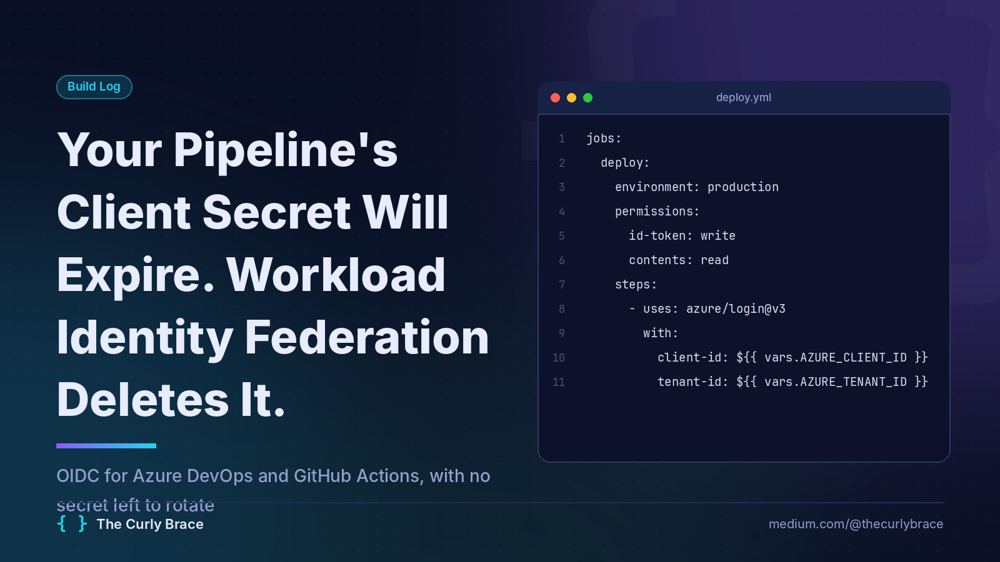
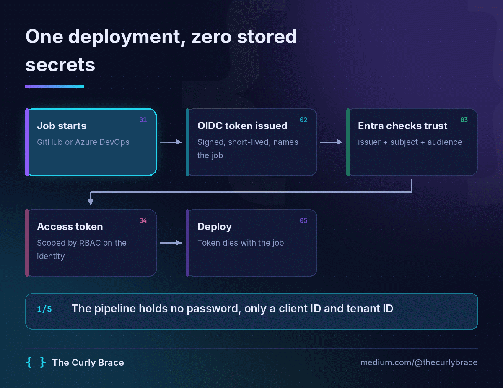
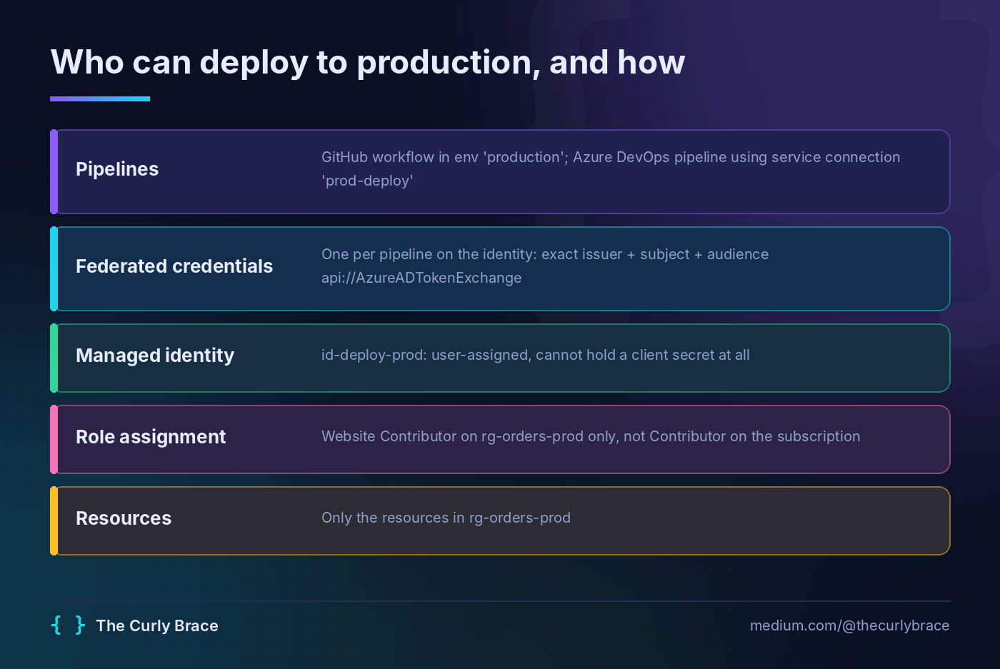
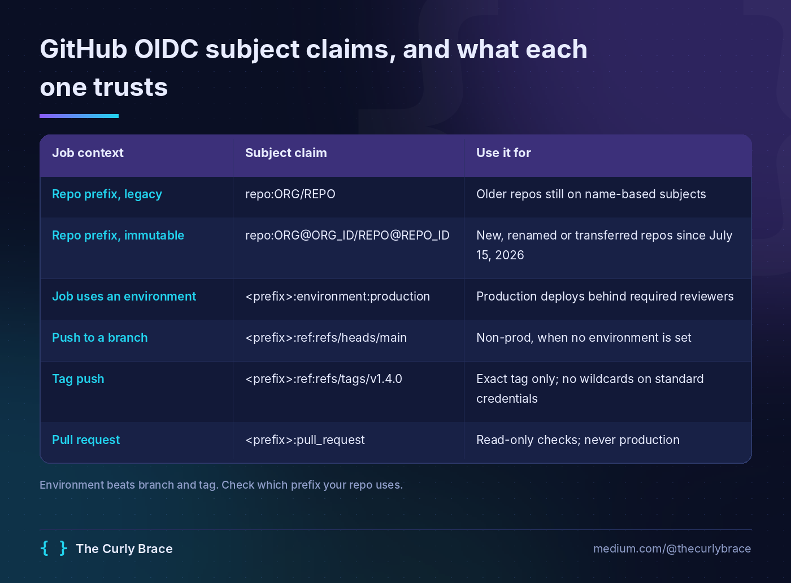
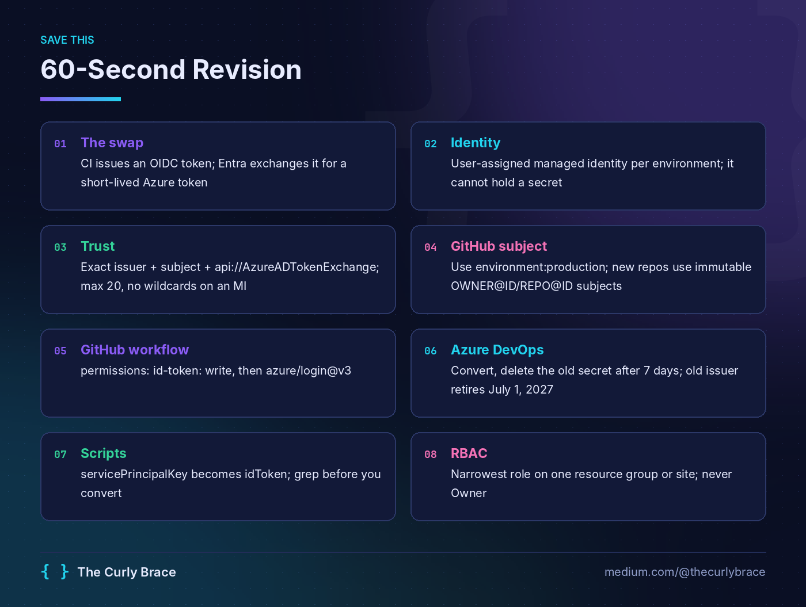

# Your Pipeline's Client Secret Will Expire. Workload Identity Federation Deletes It.

## How to move Azure DevOps and GitHub Actions to OIDC with scoped identities and exact subject claims, plus the gotchas that will still catch you.



It's 8:40 on a Tuesday morning. Every deployment pipeline in the organisation is red.

No code changed overnight. No one touched the infrastructure. Every Azure step fails with the same line:

`AADSTS7000215: Invalid client secret provided.`

Azure DevOps reports this code when a service connection's secret has expired, even though the message reads like a wrong value. (Entra's own code for an expired secret is `AADSTS7000222`.)

Twelve months ago someone created a service principal, picked an expiry from the dropdown and pasted the secret into a service connection. The calendar reminder went to someone who has since left. The secret expired quietly at midnight.

So how do you make sure this never happens again? You don't build a better rotation process. You remove the secret.

## Rotation was never going to fix this

The first fix everyone reaches for is a better process. Put the expiry in a shared calendar. Write a script that rotates the secret every 90 days and updates the service connection. Store it in Key Vault and have the pipeline read it from there.

Every one of these still leaves a long-lived credential in the system. It sits in a service connection, a repository secret, or the memory of the engineer who pasted it. The rotation script needs its own credential to rotate the others. Key Vault needs an identity to read from it. You have added steps without reducing the risk.

The exposure doesn't go away either. A client secret works from anywhere: your hosted agent, a laptop, or a server in another country. If it leaks through a log line, a fork or a misconfigured variable group, whoever has it can use it until it expires. (I covered what the first 20 minutes after a leak look like in [I Pushed a Database Password to GitHub](https://medium.com/@thecurlybrace/i-pushed-a-database-password-to-github-heres-what-happens-in-the-next-20-minutes-ab8cee1918ef).)

My position: in 2026, a long-lived secret in a CI pipeline that deploys to Azure can't be defended. Both major CI systems support a better option, it costs nothing, and the migration is a small, mostly mechanical change per pipeline.

## How federation works without a password

Think of a hotel that has stopped issuing permanent room keys. When you arrive, the front desk checks your booking and gives you a key card that works for one room, for one stay. Nobody has a master key to lose. If a card goes missing, it stops working soon anyway.

Workload identity federation works the same way. The CI system (GitHub, or Azure DevOps) is the booking system. When a job runs, it issues a signed OIDC token that says which job is running. For example: "this is repo `contoso/orders-api`, running in environment `production`." Microsoft Entra ID is the front desk. It checks the token against a **federated credential** you configured on an identity. If the issuer, subject and audience match exactly, Entra returns a short-lived Azure access token.



The pipeline now stores only a client ID, a tenant ID and a subscription ID. These are identifiers. On their own they can't be exchanged for anything, so in GitHub you can keep them as variables (`vars.*`) rather than secrets.

## The architecture: one identity per environment, trust per pipeline

This is the design I recommend you build:

- One **user-assigned managed identity** per environment (`id-deploy-staging`, `id-deploy-prod`).
- Each identity has a **role assignment scoped to one resource group** and only the role the deployment needs.
- Each identity has one **federated credential per pipeline** allowed to use it. The GitHub credential is tied to a GitHub environment. The Azure DevOps credential is tied to a specific service connection.



Three decisions matter. Each one has a reasonable alternative that I'd reject.

## Decision 1: a managed identity, not an app registration

Both work. Microsoft's docs support federated credentials on either an [app registration or a user-assigned managed identity](https://learn.microsoft.com/en-us/azure/developer/github/connect-from-azure-openid-connect).

I'd reject the app registration for one reason: someone can add a client secret back to it. Six months from now, someone needs to run a deployment from a laptop "just once" and clicks **New client secret**. You're back where you started, and nobody is notified. A user-assigned managed identity can't have a client secret, so that shortcut doesn't exist.

The other benefits are practical. A managed identity is an Azure resource. It lives in a resource group, you declare it in Bicep next to everything else, and creating it doesn't require permission to register Entra applications. Many tenants restrict that permission anyway.

One cost: there's a [hard limit of 20 federated credentials](https://learn.microsoft.com/en-us/entra/workload-id/workload-identity-federation-considerations) per identity, and wildcards aren't supported in any field of a standard federated credential. One identity per environment, with a few pipelines each, stays well under that limit. One identity shared by the whole organisation won't.

Flexible federated credentials on app registrations can pattern-match claims; managed identities can't. That's a real trade-off of this decision: you give up wildcards to make sure no one can add a secret back.

## Decision 2: trust the environment, not the branch

GitHub sets the token's `sub` claim based on the job's context, and the federated credential has to match it exactly. This is the first thing that will catch you out.



I'd reject branch-based trust (`ref:refs/heads/main`) for production. Anyone who can push to `main`, or get a workflow change merged into it, gets production credentials. Environment-based trust adds GitHub's environment protection rules on top: required reviewers, wait timers, and limits on which branches can deploy. The token can't be issued until those checks pass.

The precedence rule from [GitHub's OIDC reference](https://docs.github.com/en/actions/reference/security/oidc) causes most first-day failures. If you add `environment: production` to a job that used to rely on a branch-based credential, the subject changes and the exchange fails. Change the job and the credential together.

The second trap is the subject format itself. Since July 15, 2026, GitHub gives every repository created, renamed or transferred on github.com an [immutable default subject](https://github.blog/changelog/2026-04-23-immutable-subject-claims-for-github-actions-oidc-tokens/) that includes the owner ID and repository ID: `repo:OWNER@OWNER_ID/REPO@REPO_ID:environment:production`. Older repositories keep the name-based format unless they opt in. Copy a name-based subject for a new repository and the exchange fails with `AADSTS70021`. Renaming or transferring an older repository switches it to the new format too, so update the credential in the same change. GitHub Enterprise Server doesn't use immutable subjects.

The new format is also safer. With a name-based subject, a different repository that later ends up with the same owner and name produces tokens that match your credential. That's subject recycling, and IDs stop it. Microsoft's [guide to immutable subjects](https://learn.microsoft.com/en-us/entra/workload-id/workload-identities-github-immutable-subjects) covers migrating existing credentials. To find the IDs, run `gh api repos/OWNER/REPO --jq '.owner.id, .id'`.

## Decision 3: scope the role to the resource group, not the subscription

The automatic Azure DevOps setup asks for a subscription and lets you leave the resource group empty. Many teams then give that identity Contributor on the whole subscription. Federation removes the leaked-secret risk. It does nothing about a job that has more permission than it needs.

A pipeline that deploys an App Service needs to deploy to one App Service. `Website Contributor` on that resource group is enough, but know what it grants: it covers every site in the resource group, and `Microsoft.Web/sites/*` includes reading app settings and connection strings. If the resource group holds more than this one app, the tighter option is to assign the role on the site itself by setting `scope` on the role assignment in Bicep. If the pipeline also runs Bicep that creates resources, give it Contributor on that resource group and nothing wider. Never give it `Owner` or `User Access Administrator`: a pipeline that can grant roles can grant itself anything.

## The critical code

Here is the identity, the GitHub trust and the scoped role, all in Bicep. Deploy it with your own account or a bootstrap pipeline that has rights to create role assignments. The deploy identity should never deploy itself.

```bicep
param location string = resourceGroup().location
param githubOwner string = 'contoso'
param githubOwnerId string
param githubRepoName string = 'orders-api'
param githubRepoId string

// Website Contributor (built-in role definition ID)
var websiteContributor = 'de139f84-1756-47ae-9be6-808fbbe84772'

resource deployId 'Microsoft.ManagedIdentity/userAssignedIdentities@2023-01-31' = {
  name: 'id-deploy-prod'
  location: location
}

resource githubProd 'Microsoft.ManagedIdentity/userAssignedIdentities/federatedIdentityCredentials@2023-01-31' = {
  parent: deployId
  name: 'github-orders-api-production'
  properties: {
    issuer: 'https://token.actions.githubusercontent.com'
    // Immutable subject; legacy repos use 'repo:${githubOwner}/${githubRepoName}:environment:production'
    subject: 'repo:${githubOwner}@${githubOwnerId}/${githubRepoName}@${githubRepoId}:environment:production'
    audiences: [ 'api://AzureADTokenExchange' ]
  }
}

resource deployRole 'Microsoft.Authorization/roleAssignments@2022-04-01' = {
  name: guid(resourceGroup().id, deployId.id, websiteContributor)
  properties: {
    roleDefinitionId: subscriptionResourceId('Microsoft.Authorization/roleDefinitions', websiteContributor)
    principalId: deployId.properties.principalId
    principalType: 'ServicePrincipal'
  }
}

output clientId string = deployId.properties.clientId
```

If you add more federated credentials to the same identity, chain them with `dependsOn`. Entra rejects concurrent writes to credentials on one managed identity with a `409 Conflict`.

The GitHub workflow is short. The job needs `id-token: write`, or it can't request the OIDC token at all.

```yaml
name: deploy
on:
  push:
    branches: [main]

jobs:
  deploy:
    runs-on: ubuntu-latest
    environment: production
    permissions:
      id-token: write
      contents: read
    steps:
      - uses: actions/checkout@v5
      - run: dotnet publish -c Release -o ./publish
      - uses: azure/login@v3
        with:
          client-id: ${{ vars.AZURE_CLIENT_ID }}
          tenant-id: ${{ vars.AZURE_TENANT_ID }}
          subscription-id: ${{ vars.AZURE_SUBSCRIPTION_ID }}
      - uses: azure/webapps-deploy@v3
        with:
          app-name: app-orders-prod
          package: ./publish
```

Once a job sets its own `permissions`, every scope it doesn't list is set to none. That's why `contents: read` is there: without it, checkout can fail.

## Azure DevOps: convert first, then fix the scripts

On Azure DevOps, you may not need to create anything. If Azure DevOps created the service connection automatically and only one project uses it, the [conversion tool](https://learn.microsoft.com/en-us/azure/devops/pipelines/library/connect-to-azure) switches it to workload identity federation in place. Open **Project settings > Service connections**, select the connection and choose **Convert**. If the secret has already expired, the page shows a different conversion option. Pipelines keep referring to the connection by name, so no YAML changes. You can revert within seven days. After that, reverting means creating a new secret by hand.

Treat conversion as a quick win, not the end state. It keeps the app registration Azure DevOps created, which is exactly the kind of identity Decision 1 warns about: someone can add a client secret back to it. Once the seven-day revert window has passed, open the app registration in Entra, go to **Certificates & secrets** and delete any client secret still listed there. Later, replace the connection with one that uses the managed identity, as below.

Connections you created manually, or that are shared across projects, can't be converted. For those, and as the end state for the rest, create a new workload identity federation connection, select the managed identity, and add the federated credential Azure DevOps generates:

```bash
az identity federated-credential create \
  --name ado-prod-deploy \
  --identity-name id-deploy-prod \
  --resource-group rg-orders-prod \
  --issuer "<Issuer from the service connection>" \
  --subject "<Subject identifier from the service connection>" \
  --audiences api://AzureADTokenExchange
```

Copy the issuer and subject from the service connection page. Don't build them yourself. New connections use the Microsoft Entra issuer (`https://login.microsoftonline.com/<tenant-id>/v2.0`). Older federated connections used `https://vstoken.dev.azure.com/<org-id>`, which is [deprecated and retires on July 1, 2027](https://learn.microsoft.com/en-us/azure/devops/pipelines/release/convert-service-connections). If you migrated early, check for the deprecation flag in your service connection list and use the **Update** action on flagged connections.

Converting the connection is the easy part. What actually breaks are scripts that read the secret directly. Teams often run Terraform from `AzureCLI@2` with `addSpnToEnvironment: true`. That option sets `servicePrincipalKey` for secret-based connections and `idToken` for federated ones. A script that reads `$servicePrincipalKey` now gets an empty value:

```yaml
- task: AzureCLI@2
  inputs:
    azureSubscription: prod-deploy
    scriptType: bash
    scriptLocation: inlineScript
    addSpnToEnvironment: true
    inlineScript: |
      export ARM_CLIENT_ID=$servicePrincipalId
      export ARM_TENANT_ID=$tenantId
      export ARM_SUBSCRIPTION_ID=$(az account show --query id -o tsv)
      export ARM_OIDC_TOKEN=$idToken
      export ARM_USE_OIDC=true
      terraform apply -auto-approve
```

The azurerm 4.x provider requires a subscription ID, hence `ARM_SUBSCRIPTION_ID`. `ARM_OIDC_TOKEN` passes a raw token that can't be refreshed, so a long `terraform apply` can hit the `AADSTS700024` error described below. For long applies, use the azurerm provider's built-in Azure DevOps service-connection OIDC support instead, which requests fresh tokens from the pipeline. The provider's authentication guide lists the variables it needs.

Search your repositories for `servicePrincipalKey` before you convert anything. Each match is a script that will break.

## The five ways this will still catch you

**Entra accepts a typo in the subject when you save it.** A federated credential with a wrong subject is created without error, and the problem only shows up at token exchange. Microsoft's own docs warn about this. When you see `AADSTS70021: No matching federated identity record found`, decode the token's actual `sub` claim and compare it to the credential character by character.

**New credentials take a few minutes to propagate.** A credential you just created can return the same `AADSTS70021` for several minutes while it replicates. Wait before you start debugging what looks like a mismatch.

**Long jobs can outlive the token.** The CI token is short-lived. If a job logs in and then spends a long time building before its first Azure call, you can get `AADSTS700024: Client assertion is not within its valid time range`. Microsoft's guidance for Azure DevOps is to make Azure calls early in the script, so the access token is cached for later commands. For runs longer than about an hour, it recommends a managed identity, whose tokens last around 24 hours. In GitHub Actions, run `azure/login` immediately before the step that needs it.

**Renames break the old subject format.** The older Azure DevOps subject was `sc://<org>/<project>/<connection>`. Rename the project and the subject no longer matches. Converting to the Entra issuer gives you a new subject identifier; check it on the connection page rather than assuming it survives a rename. The same applies on GitHub: renaming a repository moves it to the immutable subject format.

**Unused connections get disabled.** Azure Pipelines can disable Azure Resource Manager service connections that haven't been used for 100 days. A quarterly disaster-recovery pipeline that has been idle for months can fail on the day you need it, for a reason unrelated to federation. Run it on a schedule.

## When a secret is still the only option

If your CI provider can issue OIDC tokens, a stored secret is a choice, not a constraint. A few cases still take that choice away:

- **The CI system can't issue OIDC tokens.** Federation needs a signed token from the provider. Without one, there's nothing to exchange.
- **A Marketplace task doesn't support federation yet.** Some third-party Azure DevOps tasks still expect a secret-based service connection. Replace the task, or keep that one connection on a secret until it's updated.
- **Your tenant restricts workload identity federation.** The exchange fails with errors such as `AADSTS700223` or `AADSTS700238`, and only the tenant's administrators can change that.

Some setups support federation but with caveats. GitHub Enterprise Server doesn't use immutable subjects, so renames and recycled names remain your problem. Sovereign clouds and multitenant app scenarios are excluded from the Azure DevOps move to the Entra issuer, so follow the guidance for your cloud.

If you're stuck with a secret, give it the shortest expiry you can operate, the narrowest role, and an owner who isn't a single person.

## What you end up with, and what to do from day one

After you migrate, there's no expiry date to track and no secret in a variable group. Nothing in the pipeline works on its own if it's copied. Access to production depends on GitHub environment protection rules and an RBAC assignment in Bicep that you can review in a pull request, not on a value someone pasted a year ago.

Three things are worth doing from the start.

First, declare the identities and federated credentials in Bicep from day one. Credentials created in the portal are hard to bring under review later. Who can deploy to production is a security decision, and it belongs in version control.

Second, add an Azure Policy or a scheduled check that flags any app registration with a client secret in the tenant, and treat each one as a defect. Federation only helps if the secrets are actually deleted.

Third, go further than this article and remove the remaining secrets from the applications themselves. Remember that a deploy identity with `Website Contributor` can read app settings, connection strings included. That's the same idea on the runtime side, which I covered in [I Deleted Every Connection String From Our Azure Apps](https://medium.com/@thecurlybrace/i-deleted-every-connection-string-from-our-azure-apps-managed-identity-did-the-rest-8313641344e4). A secret-free pipeline that deploys an app full of connection strings has only solved half the problem.



> A secret you have to rotate is a secret you will eventually forget. Federate the trust, scope the role, and delete the secret.

**Do this today:** open your Azure DevOps service connections and your GitHub repository secrets, and list every one that still holds a client secret, along with its expiry date. That list is your migration backlog, and the earliest expiry date is your deadline.

My question for the responses: outside the cases above, is there any CI deployment to Azure where a long-lived client secret is still justified in 2026? I say no. Tell me I'm wrong.

**Follow The Curly Brace for more backend war stories — no theory, only scars.**
