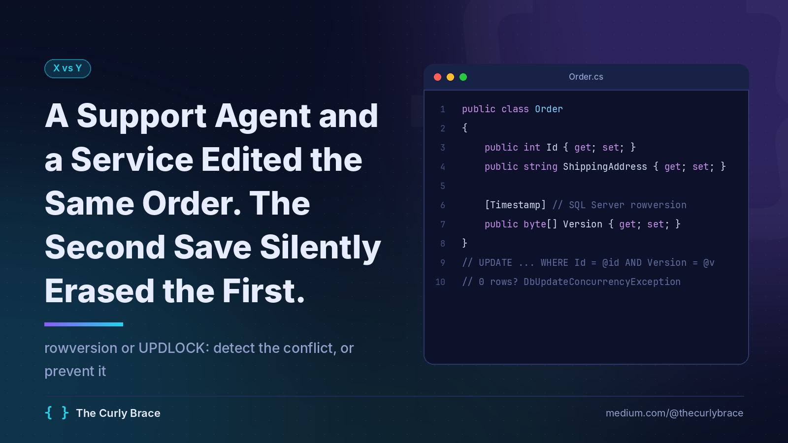
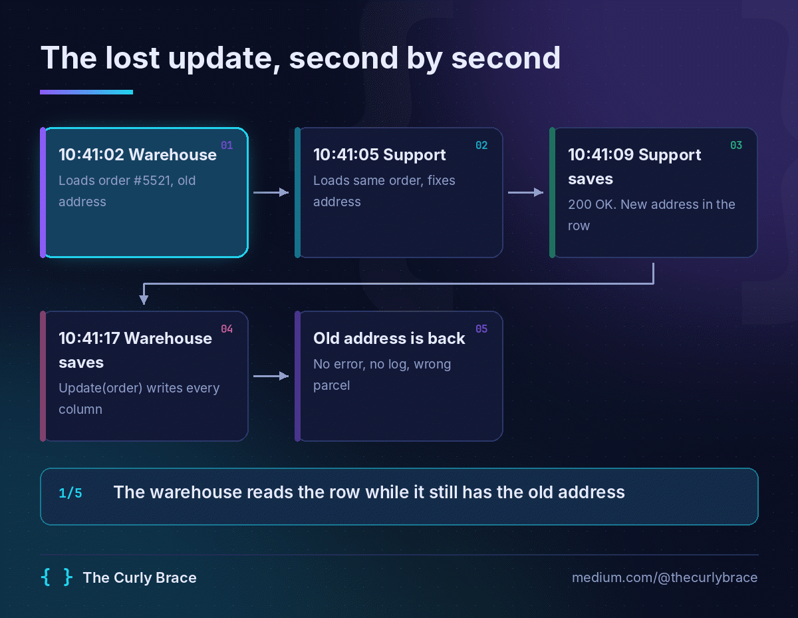
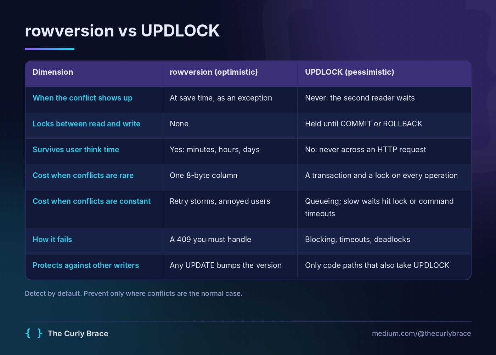
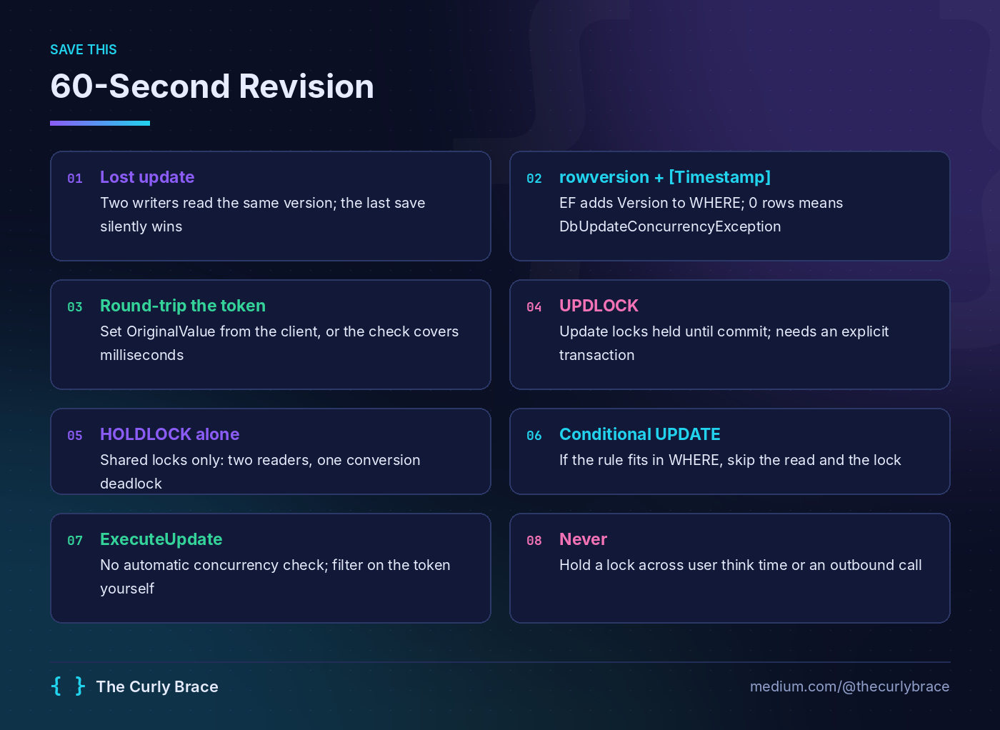

# A Support Agent and a Service Edited the Same Order. The Second Save Silently Erased the First.

## Optimistic concurrency with rowversion should be your default, and UPDLOCK belongs on exactly one kind of row.



It's 10:41 a.m. A customer calls in: the parcel is about to go to their old flat.

Your support agent fixes the address and clicks Save. 200 OK. Green toast.

Eight seconds later the warehouse service marks the order as Picked. The old address goes back into the row with it.

No exception. No log line. The parcel ships to the wrong door.

So which do you want: something that detects the conflict when you save, or a lock that stops it from happening at all?

## Nothing in your code threw. That's the problem.

Each request did exactly what it was told. The warehouse service loaded order #5521 a few seconds before the correction, mapped its message onto the entity, and called `db.Orders.Update(order)`. `Update()` marks every property as modified, so EF Core wrote every column. That included the address it had read before the fix.

First, stop calling `Update()` on mapped entities. Set only the properties you changed on a tracked entity, or use `ExecuteUpdate` on `Status`. That removes this bug. rowversion is still needed for the case where both writers touch the same column.

This is the classic lost update. Two writers read the same version, and the last one to save wins. SQL Server's default isolation does nothing to stop it, because neither statement was ever in conflict with the other. They happened at different times.



## Two ways to guard the filing cabinet

Picture the order as a paper folder in a filing cabinet.

**Optimistic** means a version stamp on the folder. Anyone can take a photocopy and work on it. The clerk only files your changes if the stamp on your copy still matches the stamp in the cabinet. If it doesn't, your form comes back with "someone got here first."

**Pessimistic** means taking the folder out of the cabinet. Nobody else can work on it until you bring it back. Nothing ever conflicts, but everyone else waits in the corridor.

### rowversion: check the stamp at save time

A SQL Server `rowversion` column is an 8-byte value that the database changes on every update to the row. Mark it with `[Timestamp]` (or `.IsRowVersion()`) and EF Core adds it to the `WHERE` clause of every `UPDATE` and `DELETE`. If someone changed the row in the meantime, zero rows match, and `SaveChanges` throws `DbUpdateConcurrencyException`. The [EF Core concurrency docs](https://learn.microsoft.com/en-us/ef/core/saving/concurrency) walk through the generated SQL.

No locks are held between the read and the write. That's why it works across HTTP requests, browser tabs and coffee breaks.

### UPDLOCK: take the folder out

`WITH (UPDLOCK)` on a `SELECT` takes update locks and, according to the [table hints reference](https://learn.microsoft.com/en-us/sql/t-sql/queries/hints-transact-sql-table), holds them "until the transaction completes." Update locks are incompatible with each other, so a second reader using `UPDLOCK` waits until the first one commits. Plain readers aren't blocked, and that will matter later.

Why not just `HOLDLOCK`? `HOLDLOCK` is the same as `SERIALIZABLE`. It holds *shared* locks, and two sessions can both hold one. Then both try to upgrade to exclusive and you get a textbook conversion deadlock. (I went through how you cause your own deadlocks in [Advanced SQL: Window Functions, Isolation Levels, and the Deadlock You Caused Yourself](https://medium.com/@thecurlybrace/advanced-sql-window-functions-isolation-levels-and-the-deadlock-you-caused-yourself-9dbb17d39376).) Use `UPDLOCK, HOLDLOCK` together only when the row might not exist yet (an upsert) or you need to lock a key range against inserts.

## Where they actually differ



The last row is the one people miss. A `rowversion` changes whatever touched the row: a stored procedure, a script someone ran at 2 a.m., a service you didn't know existed. `UPDLOCK` only coordinates the callers that agreed to use it.

## The same fix, twice

### Optimistic: rowversion with EF Core

```csharp
using System.ComponentModel.DataAnnotations;
using Microsoft.EntityFrameworkCore;

public class Order
{
    public int Id { get; set; }
    public string ShippingAddress { get; set; } = "";
    public string Status { get; set; } = "";

    [Timestamp]
    public byte[] Version { get; set; } = null!;
}

[PrimaryKey(nameof(ProductId), nameof(WarehouseId))]
public class InventoryItem
{
    public int ProductId { get; set; }
    public int WarehouseId { get; set; }
    public int OnHand { get; set; }
}

public class Reservation
{
    public int Id { get; set; }
    public int OrderId { get; set; }
    public int ProductId { get; set; }
    public int WarehouseId { get; set; }
    public int Qty { get; set; }
}

public class ShopDb(DbContextOptions<ShopDb> options) : DbContext(options)
{
    public DbSet<Order> Orders => Set<Order>();
    public DbSet<InventoryItem> Inventory => Set<InventoryItem>();
    public DbSet<Reservation> Reservations => Set<Reservation>();
}
```

Now the endpoint. One line in it matters more than everything else:

```csharp
using Microsoft.AspNetCore.Http;
using Microsoft.EntityFrameworkCore;

public record AddressChange(string Address, string Version);

public static class OrderEndpoints
{
    public static async Task<IResult> ChangeAddress(int id, AddressChange change, ShopDb db)
    {
        var token = new byte[8];
        if (change.Version is null
            || !Convert.TryFromBase64String(change.Version, token, out var written)
            || written != 8)
            return Results.BadRequest("Missing or invalid version.");

        var order = await db.Orders.FindAsync(id);
        if (order is null) return Results.NotFound();

        // Compare against the version the user saw, not the one we just loaded.
        db.Entry(order).Property(o => o.Version).OriginalValue = token;

        order.ShippingAddress = change.Address;

        try
        {
            await db.SaveChangesAsync();
            return Results.Ok(new { Version = Convert.ToBase64String(order.Version) });
        }
        catch (DbUpdateConcurrencyException)
        {
            return Results.Conflict("This order changed since you opened it. Reload and retry.");
        }
    }
}
```

The client gets `Version` when it loads the order and sends it back with the edit. If you prefer HTTP semantics, put it in an `ETag` and return 412 on a mismatched `If-Match`. The mechanism is the same either way.

For machine writers like the warehouse service, don't show anyone a 409. Catch the exception, reload, reapply only your change (the status), and retry a bounded number of times.

### Three ways rowversion will still surprise you

**The token never left the server.** If you skip the `OriginalValue` line, EF compares against the version it loaded a millisecond earlier in the same request. The check covers almost no time at all. Round-trip the token or you haven't fixed anything.

**ExecuteUpdate doesn't check it.** The [ExecuteUpdate docs](https://learn.microsoft.com/en-us/ef/core/saving/execute-insert-update-delete#concurrency-control-and-rows-affected) say plainly that these methods "cannot automatically apply concurrency control." Put the version in your `Where` and check that the affected-row count is 1.

**It protects the whole row.** A status change by the warehouse will also conflict with an address edit, even though the two columns have nothing to do with each other. If those false conflicts hurt, switch to an application-managed `[ConcurrencyCheck]` token that you only bump for the column groups that matter. Or split the row.

### Pessimistic: UPDLOCK inside a transaction

This is the stock reservation path: a hot set of rows that every checkout hits, and a decision that takes several steps. Check stock across the warehouses, record a reservation, then decrement the one you picked.

```csharp
using Microsoft.EntityFrameworkCore;

public static class InventoryService
{
    public static async Task<bool> ReserveStock(ShopDb db, int orderId, int productId, int qty)
    {
        await using var tx = await db.Database.BeginTransactionAsync();

        var stock = await db.Inventory
            .FromSql($"SELECT * FROM Inventory WITH (UPDLOCK, ROWLOCK) WHERE ProductId = {productId}")
            .ToListAsync();

        var source = stock.FirstOrDefault(i => i.OnHand >= qty);
        if (source is null) return false;   // disposing tx rolls back, locks released

        db.Reservations.Add(new Reservation
        {
            OrderId = orderId,
            ProductId = productId,
            WarehouseId = source.WarehouseId,
            Qty = qty
        });
        source.OnHand -= qty;

        await db.SaveChangesAsync();
        await tx.CommitAsync();
        return true;
    }
}
```

The transaction is not optional. Without one, the `SELECT` runs in autocommit and the lock is released the moment it returns. The hint is still there, it just protects nothing.

## My hot take: half the time you need neither

Now strip that reservation down: one warehouse, no reservation row. The whole business rule becomes "decrement if there's enough." That fits in a `WHERE` clause:

```csharp
var reserved = await db.Inventory
    .Where(i => i.ProductId == productId
             && i.WarehouseId == warehouseId
             && i.OnHand >= qty)
    .ExecuteUpdateAsync(s => s.SetProperty(i => i.OnHand, i => i.OnHand - qty));

return reserved == 1;
```

That's a single atomic `UPDATE` (EF Core 7+), with no read, no lock hint and no window between check and write. `UPDLOCK` earns its place when the decision really does need several steps in C#, like the version above: check stock across two warehouses, write a reservation row, then decrement. If the rule fits in one statement, write one statement.

## Pick one in ten seconds

**Use rowversion** when the read and the write happen in different requests, especially with a human in between. That covers every edit screen, every PATCH endpoint, every aggregate a user can open in two tabs. Make it the default on every table people edit.

**Use UPDLOCK** when all of these are true: read, decide and write happen in one short transaction; the row is hot enough that conflicts are normal, not rare; and the decision can't be written as a single conditional `UPDATE`. That's the one kind of row UPDLOCK belongs on: a short-lived, hot row where read, decide and write take several statements. Inventory where the reservation needs more than one statement, seat holds and per-tenant quota rows qualify. Order headers don't.

**Use a conditional UPDATE** when the rule fits in a `WHERE` clause. It beats both.

**Never hold UPDLOCK** across user think time, an outbound HTTP call or an LLM call. A transaction that waits on something outside the database turns your hottest row into a queue.

## The wrong choice, and what it costs

The usual reaction to a lost-update bug is "we need a lock." So someone adds `UPDLOCK` to the query that loads the edit screen. In autocommit that does nothing. If someone "fixes" it by holding a transaction open across the request, it's worse: a connection pinned per open screen, blocked writers, and pool exhaustion the next time traffic spikes. That's the 2 a.m. page you were trying to avoid.

The quieter mistake goes the other way: `UPDLOCK` on one code path and not on another. Update locks don't block plain readers on any SQL Server, because S and U are compatible. On Azure SQL Database, where `READ_COMMITTED_SNAPSHOT` is on by default, the unhinted read doesn't even wait for the other session's uncommitted write. Either way, it reads the old value and overwrites. Your lost update is back, plus some blocking.



> Detect conflicts by default with rowversion. Lock only short, hot rows, and only when the rule doesn't fit in a single UPDATE.

Do this today: search your codebase for `.Update(` on entities built from DTOs, and check whether any of those tables has a concurrency token. Each one that doesn't can lose an update right now without telling anyone.

Here's my challenge: is there any table a human edits where you'd pick UPDLOCK over rowversion? Name it in the responses and tell me I'm wrong.

**Follow The Curly Brace for more backend war stories — no theory, only scars.**
