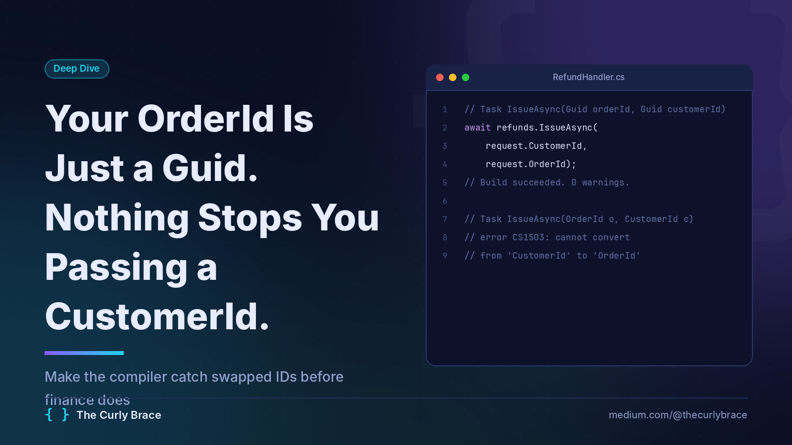
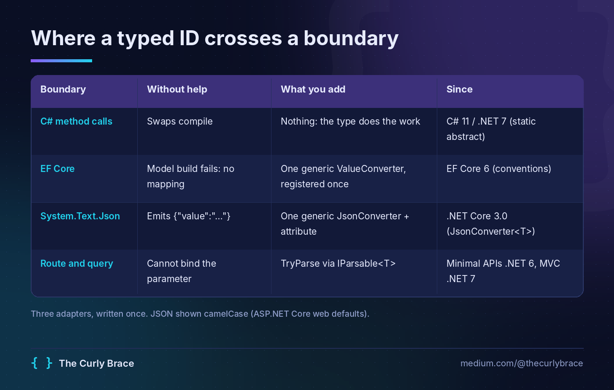

# Your OrderId Is Just a Guid. Nothing Stops You Passing a CustomerId.

## Strongly typed IDs turn a silent wrong-order refund into a compile error, and wiring them through EF Core, JSON and routes takes under twenty lines per ID.



It's 4:40 p.m. on a Thursday. Finance sends you one line: "Refund RF-20931 points at order 7c1e09a2… That order doesn't exist."

The customer who asked for the refund has emailed twice. Their real order still shows as paid.

You open the handler and find the bug in under a minute:

```csharp
await refunds.IssueAsync(request.CustomerId, request.OrderId, request.Amount);
```

The signature is `IssueAsync(Guid orderId, Guid customerId, decimal amount)`. The refund service lives in its own database, has no foreign key back to orders, and wrote the row without complaint. The compiler saw two Guids going into two Guid slots and had no reason to object.

There's a worse version of this bug. Swap `originalOrderId` and `replacementOrderId` and you refund a real order that belongs to the same customer. Nothing in the system flags it, and typed IDs alone won't either. We'll come back to that one at the end.

So how do you make this mistake impossible to compile without burying the codebase in ceremony?

## Every Guid looks the same to the compiler

Picture a server rack where every cable is grey and has the same connector. Power, network and storage all look alike, and all of them fit every port. Labels help until someone is tired. Keyed connectors fix it properly: an HDMI plug won't go into a USB-C port, however tired you are.

A `Guid` is the grey cable. `OrderId`, `CustomerId` and `PaymentId` are all the same type to C#, so the type system can't tell you that you plugged one into the wrong slot. A strongly typed ID is the keyed connector. It holds the same 16 bytes but has a different type, so a mismatch fails at build time.

The odds also get worse as signatures grow. With *n* ID types that share one primitive and meet in the same signatures, there are n(n-1)/2 pairs you can confuse. Three give you 3 pairs. Ten give you 45.

## The type is under twenty lines

Use a `readonly record struct`. You get value equality, `==` and `GetHashCode` for free. It's a struct, so there's no heap allocation and no null to check. `readonly` means EF Core can snapshot and compare it safely.

Start with a small interface. It gives the infrastructure code later in this article something generic to work with:

```csharp
public interface IGuidId<TSelf> where TSelf : struct, IGuidId<TSelf>
{
    Guid Value { get; }
    static abstract TSelf From(Guid value);
}
```

Then the ID itself:

```csharp
using System.Diagnostics.CodeAnalysis;

public readonly record struct OrderId(Guid Value) : IGuidId<OrderId>, IParsable<OrderId>
{
    public static OrderId New() => new(Guid.NewGuid());
    public static OrderId From(Guid value) => new(value);
    public override string ToString() => Value.ToString();

    public static OrderId Parse(string s, IFormatProvider? provider)
        => new(Guid.Parse(s, provider));

    public static bool TryParse([NotNullWhen(true)] string? s,
        IFormatProvider? provider, out OrderId result)
    {
        var ok = Guid.TryParse(s, provider, out var value) && value != Guid.Empty;
        result = new(value);
        return ok;
    }
}
```

Three things to notice:

- **`static abstract`** needs C# 11 / .NET 7 or later. Everything here runs on .NET 10 (LTS) and .NET 11. If you're still on .NET 8, it went out of support on November 10, 2026.
- **The `ToString` override matters.** A record struct's default `ToString` prints `OrderId { Value = 7c1e… }`. That ends up in your logs and in any URL you build from the ID.
- **`IParsable<T>`** looks like overhead now. It pays off in the routing section below.

Write `CustomerId` the same way, change the signature to `IssueAsync(OrderId orderId, CustomerId customerId, decimal amount)`, and the 4:40 p.m. bug becomes:

```text
error CS1503: Argument 1: cannot convert from 'CustomerId' to 'OrderId'
```

That's the whole point of the pattern. The rest of the article is about getting the type through the three boundaries where it meets the outside world.



## EF Core: one converter for every ID

EF Core doesn't know what an `OrderId` is. A [value converter](https://learn.microsoft.com/en-us/ef/core/modeling/value-conversions) tells it to store the type as a `uniqueidentifier` (or whatever your provider uses for `Guid`). Here is one generic converter that works for every ID type:

```csharp
using Microsoft.EntityFrameworkCore.Storage.ValueConversion;

public sealed class GuidIdConverter<TId> : ValueConverter<TId, Guid>
    where TId : struct, IGuidId<TId>
{
    public GuidIdConverter() : base(id => id.Value, value => Create(value)) { }

    private static TId Create(Guid value) => TId.From(value);
}
```

The private `Create` method isn't decoration. Converters are expression trees, and C# won't let an expression tree call a static abstract member directly (error CS8927). Wrapping the call in an ordinary static method gets around that.

Register the converter once per type in `ConfigureConventions` (EF Core 6+), not on every property:

```csharp
using Microsoft.EntityFrameworkCore;

public class ShopDb(DbContextOptions<ShopDb> options) : DbContext(options)
{
    public DbSet<Order> Orders => Set<Order>();

    protected override void ConfigureConventions(ModelConfigurationBuilder builder)
    {
        builder.Properties<OrderId>().HaveConversion<GuidIdConverter<OrderId>>();
        builder.Properties<CustomerId>().HaveConversion<GuidIdConverter<CustomerId>>();
    }

    protected override void OnModelCreating(ModelBuilder modelBuilder)
        => modelBuilder.Entity<Order>().Property(o => o.Id).ValueGeneratedNever();
}

public class Order
{
    public OrderId Id { get; init; } = OrderId.New();
    public CustomerId CustomerId { get; init; }
}
```

The `ValueGeneratedNever()` call is deliberate. The domain creates the ID, so EF Core shouldn't try. Key generation for converted keys only arrived in EF Core 7, and the docs still say value generation isn't supported for most converted keys. Creating the ID yourself means you don't depend on it.

That choice has a cost. For a plain `Guid` key, the SQL Server provider generates sequential GUIDs on the client by default. `Guid.NewGuid()` is random, so a clustered primary key on `uniqueidentifier` will fragment. If that matters to you, generate ordered values in `New()` instead, either with a sequential GUID generator or with `Guid.CreateVersion7()` on .NET 9+. Be aware that SQL Server sorts `uniqueidentifier` by its last bytes first, so v7 GUIDs aren't fully sequential there either.

Queries read the way you'd hope: `db.Orders.Where(o => o.CustomerId == customerId)`. If a method takes a `CustomerId` and you pass an `OrderId`, that query doesn't compile either.

## JSON: the contract you'll break without noticing

This trap catches people who did everything else right. Without a converter, System.Text.Json serializes the record struct's public property, and your API response changes from this:

```json
{ "orderId": "7c1e09a2-4b7d-4f0e-9d51-2a8c3e6b1f40" }
```

to this:

```json
{ "orderId": { "value": "7c1e09a2-4b7d-4f0e-9d51-2a8c3e6b1f40" } }
```

Your tests still pass, because they deserialize with the same types. Your mobile client breaks. One generic [custom converter](https://learn.microsoft.com/en-us/dotnet/standard/serialization/system-text-json/converters-how-to) keeps the wire format as a plain string:

```csharp
using System.Text.Json;
using System.Text.Json.Serialization;

public sealed class GuidIdJsonConverter<TId> : JsonConverter<TId>
    where TId : struct, IGuidId<TId>
{
    public override TId Read(ref Utf8JsonReader reader, Type typeToConvert,
        JsonSerializerOptions options) => TId.From(reader.GetGuid());

    public override void Write(Utf8JsonWriter writer, TId value,
        JsonSerializerOptions options) => writer.WriteStringValue(value.Value);
}
```

Put `[JsonConverter(typeof(GuidIdJsonConverter<OrderId>))]` on the `OrderId` declaration. Putting it on the type rather than in `JsonSerializerOptions` means it applies wherever the type is serialized, including places that build their own options. If you use typed IDs as dictionary keys, you'll also need to override `ReadAsPropertyName` and `WriteAsPropertyName`.

The wire format isn't the last boundary. Your OpenAPI document is what generated clients are built from, and the generator may still describe `OrderId` as an object with a `value` property, even though the converter sends a string. Check the generated schema, and if it's wrong, map typed IDs to `string` with format `uuid`: a schema transformer in Microsoft.AspNetCore.OpenApi, or `MapType` in Swashbuckle. The exact API differs between versions, so check the docs for the one you target.

## Routes: the ID binds itself

This is where `IParsable<T>` pays off. Minimal APIs bind any route, query or header parameter whose type has a static `TryParse`. That has worked since .NET 6, and [MVC controllers gained the same ability in .NET 7](https://learn.microsoft.com/en-us/aspnet/core/release-notes/aspnetcore-7.0). So this just works:

```csharp
app.MapGet("/orders/{orderId}", async (OrderId orderId, ShopDb db, CancellationToken ct) =>
    await db.Orders.SingleOrDefaultAsync(o => o.Id == orderId, ct) is { } order
        ? Results.Ok(order)
        : Results.NotFound());
```

You don't need `Guid.Parse` in the handler or a custom model binder. When parsing fails, [minimal APIs return a 400](https://learn.microsoft.com/en-us/aspnet/core/fundamentals/minimal-apis/parameter-binding) before your code runs. Bad input is rejected at the edge instead of three layers down.

## My hot take: the "ceremony" argument loses at the first pair

The objection is fair. Each ID type costs under twenty lines, plus a `[JsonConverter]` attribute and a registration line in `ConfigureConventions`. Compared with typing `Guid`, that's ceremony.

But look at where the cost falls. The converters are written once. Each new ID is a short file you copy, and it never changes again. The bug it prevents doesn't show up in testing. It shows up as bad data in production, found by someone outside engineering, often days later. You're trading a one-time cost against a recurring and unpredictable one.

So don't count aggregates in your domain. Count the IDs that meet in the same signatures. The refund bug needed only one pair: an `OrderId` and a `CustomerId` side by side, with sensible parameter names, and it still got through review. My rule of thumb: wrap an ID the first time it appears in a signature next to another ID of the same primitive type, especially on a money path. If you read [Your Abstract Base Class Is Lying to the Compiler](https://medium.com/@thecurlybrace/your-abstract-base-class-is-lying-to-the-compiler-525ea09135ca), this is the same instinct: tell the compiler the truth and it will check that truth for you.

If the boilerplate still bothers you, source generators such as [StronglyTypedId](https://github.com/andrewlock/StronglyTypedId) and Vogen will write it for you. The trade-off is another dependency, plus generated code your team has to understand when it misbehaves.

## Where it still bites

To be honest about it, the EF Core docs show this pattern with a hedge: "Showing this pattern does not mean we recommend it." Their suggestion is to "consider using navigations and generated keys instead of dealing with key values directly." That works inside one `DbContext`. It does nothing for IDs that cross service boundaries: the refund service from the opening has no foreign key back to orders, so there's no navigation to use. That's where typed IDs earn their keep. Still, the docs are right that the pattern isn't free. Here are the sharp edges.

### `default(OrderId)` is a real value

A struct can't forbid its default value. `new OrderId()` compiles and gives you `Guid.Empty`. The `TryParse` above already rejects `Guid.Empty`, so an empty ID can't come in through a route or query. For everything else, put the guard in `From` and have it throw on `Guid.Empty`. The EF Core and JSON converters both go through `From`, so that guard also catches empty IDs in request bodies and bad rows in the database. The positional constructor still bypasses it, so create IDs through `New()` and `From` in your own code.

### Don't reach for `.Value` in LINQ

`o.Id == orderId` translates to SQL. `o.Id.Value == someGuid` doesn't, because EF Core [can't query into members of a value-converted type](https://learn.microsoft.com/en-us/ef/core/modeling/value-conversions). Compare whole IDs, never their insides.

### Raw SQL wants primitives

Raw SQL APIs don't accept parameters of value-converted types. Pass `orderId.Value` to `FromSql` and `ExecuteSql`. This is the one place where you deliberately take the ID back out of its type.

### Two IDs of the same type still swap

Back to the worse bug from the opening. `originalOrderId` and `replacementOrderId` are both `OrderId`, so swapping them still compiles. Typed IDs only catch swaps between *different* ID types. For same-type pairs, make the call site say which is which. Named arguments help (`IssueReplacementAsync(original: a, replacement: b)`), but nothing forces callers to use them. A parameter object such as `record ReplacementRequest(OrderId Original, OrderId Replacement)` is stronger, because the roles live in property names that every caller has to write.

### Don't wrap everything

IDs that cross aggregate boundaries are where the pattern earns its keep. Wrapping every `int` and `string` in your codebase gives you the ceremony without the payoff. Start with the IDs that appear in method signatures next to other IDs.

> If two parameters can be swapped without a compiler error, sooner or later someone will swap them in production.

Tonight, search your codebase for method signatures with two or more `Guid` parameters. Each one is a possible swap. Start with the one that touches money.

Struct or class for your IDs, and would you ever wrap an `int` identity key? Tell me I'm wrong.

**Follow The Curly Brace for more backend war stories — no theory, only scars.**
